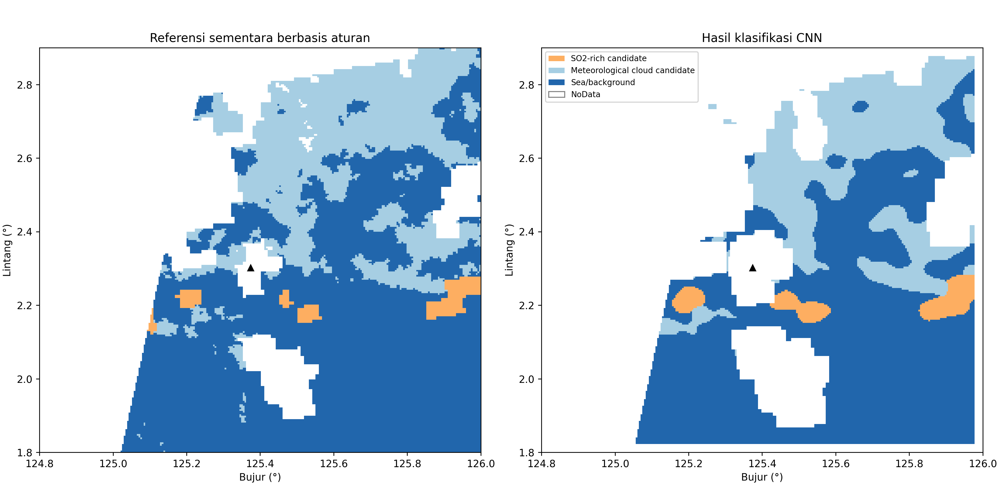
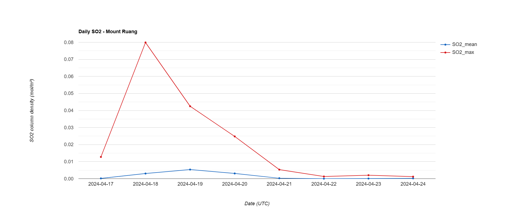
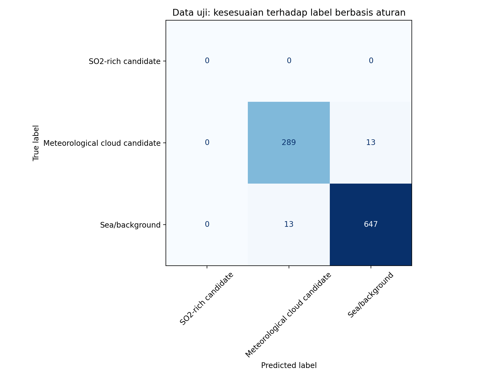
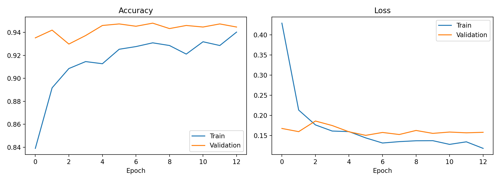
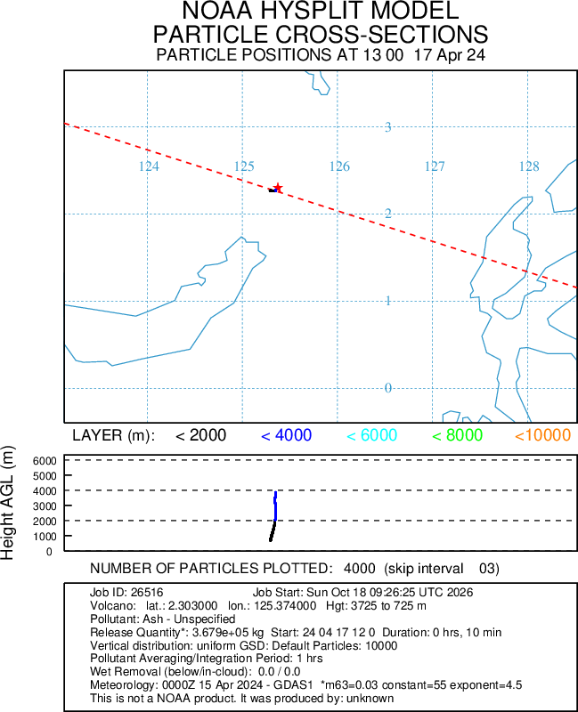
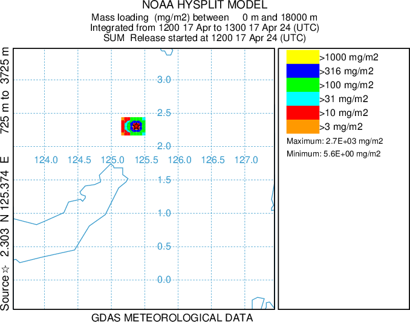
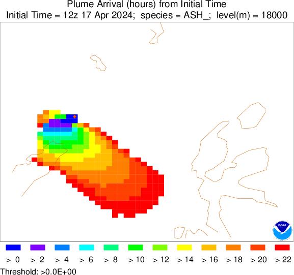
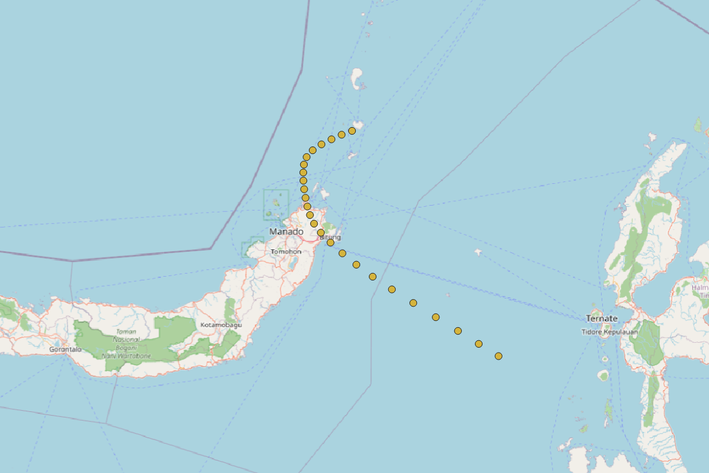

# Mount Ruang Eruption Analysis

**Satellite Remote Sensing · Deep Learning · Atmospheric Dispersion · GIS**

A geospatial case study of the April 2024 Mount Ruang eruption in Indonesia, combining satellite observations, convolutional neural network classification, and atmospheric transport simulations.

## Overview

This project brings together Google Earth Engine, Python in Google Colab, NOAA HYSPLIT, and QGIS to investigate complementary aspects of volcanic activity.

The analysis covers satellite-derived sulfur dioxide (SO₂), thermal anomalies, wind conditions, CNN image classification, and simulated volcanic plume transport. The repository contains analysis code, processed datasets, saved models, evaluation records, maps, charts, and simulation products.

The workflow was developed as an educational case study and is presented here as a geospatial analysis portfolio.

## Objectives

- Analyze daily mean and maximum SO₂ column values over the selected study region.
- Detect spectral thermal anomalies using the Normalized Hotspot Index (NHI).
- Examine wind speed and direction using ERA5 data.
- Apply and evaluate a CNN classification workflow using Sentinel-3 imagery.
- Visualize HYSPLIT particle dispersion, mass loading, and plume arrival time.
- Prepare maps and organize analytical outputs into a documented repository.

## Study Context

| Item | Description |
|---|---|
| Study site | Mount Ruang, North Sulawesi, Indonesia |
| Event | April 2024 eruption |
| Selected eruption date | 17 April 2024 |
| SO₂ analysis period | 17–24 April 2024 |
| Thermal imagery search period | 17–29 April 2024 |
| Wind snapshots | 17 April 2024, 12:00 and 15:00 UTC |
| Time convention | UTC unless otherwise indicated |

Observation dates and simulation valid times should be checked in the corresponding scripts, tables, and plot annotations. The satellite and simulation products do not necessarily cover identical periods.

## Data and Technology

| Component | Dataset or platform | Role |
|---|---|---|
| SO₂ observations | Sentinel-5P / TROPOMI | SO₂ column mapping and daily statistics |
| Thermal anomalies | Sentinel-2 | NHI calculation and visualization |
| Wind conditions | ERA5 | Wind speed and direction |
| CNN classification | Sentinel-3 / SLSTR | Satellite imagery for the classification workflow |
| Satellite processing | Google Earth Engine | Data selection, analysis, visualization, and export |
| Machine learning | Python / Google Colab | Data preparation, CNN training, inference, and evaluation |
| Atmospheric simulation | NOAA HYSPLIT | Atmospheric transport and dispersion modeling |
| GIS and cartography | QGIS | Spatial visualization and map layout production |

## Analytical Workflow

1. **Define the study settings**  
   Select the study areas, eruption date, observation periods, and processing parameters.

2. **Process SO₂ observations**  
   Filter Sentinel-5P imagery, derive daily statistics, and export the selected spatial products.

3. **Identify thermal anomalies**  
   Process Sentinel-2 imagery and calculate NHI outputs for the selected observations.

4. **Examine wind conditions**  
   Extract ERA5 wind components and derive wind speed and direction.

5. **Run the CNN workflow**  
   Prepare Sentinel-3 inputs, train the model, generate predictions, and evaluate agreement with reference labels.

6. **Compile atmospheric simulation outputs**  
   Organize HYSPLIT particle dispersion, mass loading, arrival-time plots, and GIS exports.

7. **Prepare maps and documentation**  
   Produce QGIS layouts and assemble the code, data, evaluation records, and visual outputs.

## Results Gallery

### Daily SO₂ Variation

Daily mean and maximum SO₂ values within the selected analysis region. Refer to the chart and exported table for units and observation dates.

[View daily SO₂ statistics](outputs/tables/Ruang_Daily_SO2_Statistics.csv)

### CNN Classification

Spatial classification output generated by the Python notebook. Class definitions and reference-label preparation are documented in the notebook and supporting files.

[View classification report](outputs/tables/classification_report.csv)

### Classification Evaluation

The confusion matrix summarizes agreement between model predictions and the reference labels used for evaluation.

[View confusion matrix table](outputs/tables/confusion_matrix.csv)

### Training Behavior

Training curves provide a visual record of model behavior during training.

[View training history](outputs/tables/training_history.csv)

### HYSPLIT Particle Dispersion

Animation of simulated particle transport under the selected meteorological and release conditions.

### HYSPLIT Mass Loading

Animation of simulated mass loading. Units, vertical extent, and valid times are provided in the plot annotations.

### Plume Arrival Time

Static arrival-time map from the HYSPLIT simulation. Interpret the arrival times using the initial time, threshold, and other settings shown on the plot.

### QGIS Map Layout

Map layout prepared in QGIS from the selected spatial outputs.

[Open the map PDF](outputs/maps/Peta_Trajektori_Gunung_Ruang.pdf)

## Repository Structure

| Directory | Contents |
|---|---|
| `gee/` | Google Earth Engine JavaScript |
| `notebooks/` | Python analysis notebook |
| `data/processed/` | Processed GeoTIFFs and reference arrays |
| `models/cnn/` | Saved CNN models and supporting files |
| `outputs/animations/` | HYSPLIT animations |
| `outputs/charts/` | SO₂ chart, confusion matrix, and training curves |
| `outputs/maps/` | Map images, static arrival-time map, and exported layout PDF |
| `outputs/tables/` | Statistical summaries, classification metrics, and training records |
| `qgis/` | QGIS project |
| `simulations/hysplit/results/` | HYSPLIT PDF products and simulation archive |
| `simulations/hysplit/results/gis/` | HYSPLIT GIS archive |

## Main Analysis Files

| File | Purpose |
|---|---|
| `gee/mount_ruang_so2_nhi_era5.js` | Earth Engine workflow for SO₂, NHI, and ERA5 wind analysis |
| `notebooks/Mount_Ruang_Sentinel3_CNN_2024.ipynb` | Sentinel-3 CNN workflow |
| `qgis/Trajektori_Gunung_Ruang.qgz` | QGIS visualization and mapping project |
| `models/cnn/cnn_best.keras` | Saved best model checkpoint |
| `models/cnn/cnn_final.keras` | Saved final model |
| `models/cnn/label_parameters.json` | Supporting label parameters |
| `models/cnn/normalization_and_split.npz` | Saved normalization and data-split information |
| `models/cnn/test_metrics.json` | Saved evaluation metrics |

## Getting Started

### 1. Explore the Outputs

Start with the results gallery above or browse:

- `outputs/maps/` for spatial visualizations.
- `outputs/charts/` for time-series and model evaluation figures.
- `outputs/tables/` for numerical summaries.
- `outputs/animations/` for simulated plume evolution.

### 2. Run the Google Earth Engine Script

Open `gee/mount_ruang_so2_nhi_era5.js` in the [Google Earth Engine Code Editor](https://code.earthengine.google.com/).

Before execution:

- Review the study areas and date settings.
- Check the dataset selections and processing parameters.
- Review export regions, coordinate reference systems, and pixel sizes.

Run the script in Earth Engine. Start the required export tasks from the **Tasks** panel.

The script depends on Earth Engine APIs and is intended for execution in the Earth Engine environment.

### 3. Open the Python Notebook

Open `notebooks/Mount_Ruang_Sentinel3_CNN_2024.ipynb` in [Google Colab](https://colab.research.google.com/) or a compatible Jupyter environment.

Before running the notebook:

- Review the dependency installation and import cells.
- Locate the source imagery and reference inputs specified in the notebook.
- Update Google Drive or local paths for your environment.
- Review preprocessing, class definitions, data splits, and training settings.
- Check that the required model and supporting files are available.

Run the notebook in the intended cell order. Input imagery referenced by the notebook may need to be obtained separately.

### 4. Open the QGIS Project

Open `qgis/Trajektori_Gunung_Ruang.qgz` in QGIS.

If a layer cannot be found, reconnect it to the appropriate dataset. The project file stores layer references and visualization settings; external source data must also be available.

### 5. Review HYSPLIT Products

The archived simulation products include:

- [Mass loading PDF](simulations/hysplit/results/mass_loading.pdf)
- [Particle positions PDF](simulations/hysplit/results/particle_positions.pdf)
- [Arrival-time PDF](simulations/hysplit/results/time_of_arrival.pdf)
- [Simulation archive](simulations/hysplit/results/JOBID26516.zip)
- [GIS archive](simulations/hysplit/results/gis/gis_26516.zip)

Reproducing the simulation requires the original meteorological inputs and configuration, including release location, time, height, duration, and relevant model settings. Exported plots alone do not provide a complete reproducible simulation setup.

## Evaluation and Reproducibility

Classification evaluation is provided through the confusion matrix, classification report, saved metrics, and training records.

The interpretation of these metrics depends on:

- How reference labels were produced.
- The distribution of samples across classes.
- The separation of training, validation, and test data.
- Any spatial dependence between samples.
- The preprocessing and normalization procedures.

Agreement with reference labels should not be interpreted as independent field validation unless such validation is explicitly documented.

Reproducing the wider workflow also requires compatible software dependencies, access to the original inputs, and appropriate path configuration. Exact numerical agreement may vary with data availability, software versions, and model execution settings.

## Interpretation and Limitations

### Satellite Observations

- SO₂ column values describe vertically integrated atmospheric quantities and do not directly measure ground-level exposure.
- Cloud cover, acquisition timing, spatial resolution, and processing choices affect the available observations.
- NHI identifies spectral thermal anomalies. Interpretation requires attention to cloud contamination, surface conditions, and observation timing.

### Wind Analysis

- ERA5 wind data used here describe conditions at 10 m above the surface.
- These winds provide near-surface context and do not directly represent transport winds at volcanic plume altitude.

### CNN Classification

- Model performance depends on input quality, reference labels, class balance, and data partitioning.
- Strong performance on the selected evaluation samples does not establish generalization to other dates, sensors, or locations.

### Atmospheric Simulation

- HYSPLIT results depend on meteorological inputs and release assumptions.
- Simulated particle distributions and mass loading are model outputs, rather than direct satellite measurements.
- Arrival-time maps depend on the specified release time, detection threshold, and simulation settings.

### Comparison Across Products

Satellite observations, CNN classifications, and HYSPLIT simulations represent different quantities. Comparisons should account for differences in time, spatial resolution, units, and vertical extent.

This project supports learning and exploratory analysis. It is not an operational aviation advisory, public safety forecast, or validated volcanic hazard assessment.

## Skills Demonstrated

- Satellite data processing with Google Earth Engine
- Environmental time-series analysis
- Thermal anomaly detection
- Python-based geospatial workflows
- CNN training, inference, and evaluation
- Interpretation of atmospheric dispersion products
- GeoTIFF handling and GIS project organization
- Cartographic presentation with QGIS
- Technical documentation across multiple platforms

## Data and Software Acknowledgments

The project uses data and tools provided by:

- Copernicus Sentinel missions
- European Centre for Medium-Range Weather Forecasts (ECMWF), ERA5
- Google Earth Engine
- Google Colab
- NOAA Air Resources Laboratory, HYSPLIT
- QGIS
- The open-source Python ecosystem

Third-party datasets, software, and archived materials remain subject to their respective licenses and attribution requirements.

## Collaboration

This repository presents practical work in satellite remote sensing, geospatial analysis, machine learning, and atmospheric simulation.

For project questions or collaboration inquiries, please use the contact information provided on the repository owner's GitHub profile.

## Author

**M. Dedy Lesmana**

